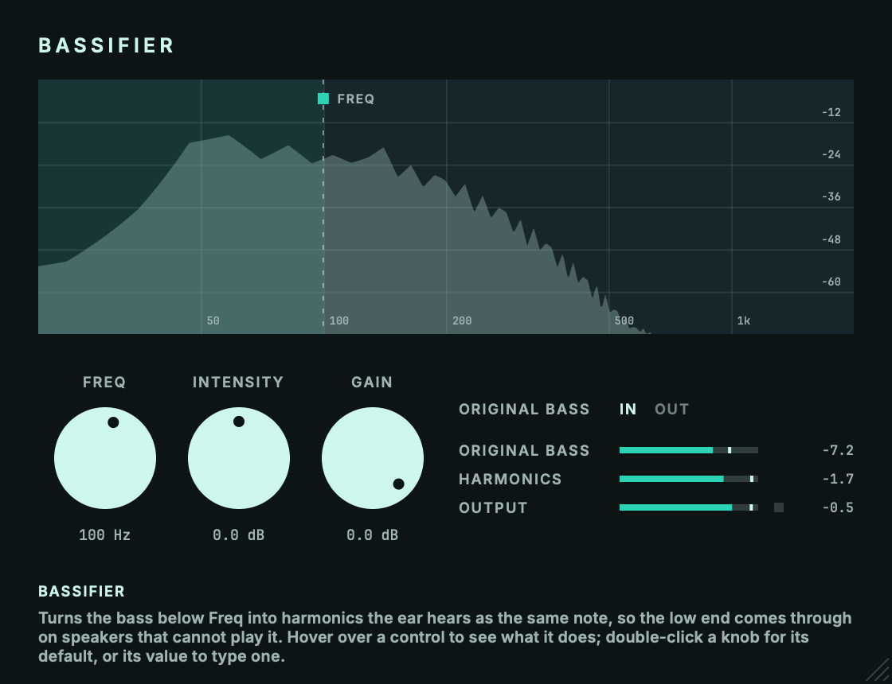

# Bassifier

A psychoacoustic bass enhancer for AU and VST3.<br>
Part of the codycodie plug-in collection.

Bassifier turns the bass below a chosen frequency into harmonics that the ear hears as the same note, so the low end comes through on speakers that cannot play it. A crossover splits the signal, the low band feeds a recursive harmonic generator with an upward compressor, and the harmonics are mixed back above the crossover. The generator's operating point, the compressor constants and the loop-gain limit are chosen for this plug-in rather than measured from any hardware or software. They are Approximations tuned by ear and by the offline checks in `tests/eval.cpp`.



Bassifier is an independent product identity. Its bundle identifier is `com.c0dypeng.bassifier`, its manufacturer code is `Cdpg` and its plug-in code is `Bsfr`. It builds as AU and VST3.

## Downloads

Get the latest packages from the [Bassifier releases page](https://github.com/chijenpeng/bassifier/releases/latest). The macOS release contains Universal AU and VST3 bundles for Apple Silicon and Intel. The Windows release contains a native x64 VST3. macOS bundles are ad-hoc signed and are not notarized; the Windows plug-in is unsigned.

## Controls

- **Freq** is the crossover, 32 to 256 Hz. Everything below it is taken out and rebuilt as harmonics above it. It is also the dashed line in the display, which can be dragged; double-click it to reset.
- **Intensity** sets how much of the generated harmonics goes into the output, -24 to +24 dB. A few dB go a long way.
- **Original Bass** In keeps the input below Freq underneath the harmonics; Out leaves only the harmonics.
- **Gain** sets the output level, from minus infinity to 0 dB.
- **Original Bass meter** shows the peak of the input below Freq, the part being replaced.
- **Harmonics meter** shows the peak of the harmonics being added, after Intensity.
- **Output meter** shows the peak of the output after Gain, with a clip light.

The meters hold their highest peak as a number. Clicking a meter resets it and the clip light. Hovering over a control explains it in the bottom-left corner. These four parameters are the only ones the plug-in exposes to the host, and every setting is saved with the session. Latency is zero.

## How it works

1. A 4th-order Linkwitz-Riley crossover splits the signal at Freq. The high band passes through. The low band, summed to mono, feeds the generator.
2. The generator multiplies the low band by a one-sample-delayed copy of its own output, so each trip round the loop turns the Nth harmonic into the (N+1)th. The result is high-passed at Freq with an 8th-order inverse Chebyshev filter.
3. An upward compressor's control signal scales the harmonics inside the loop and at its output, so quiet bass gets proportionally more harmonics than loud bass. With the default settings the second harmonic's level follows the input with a slope of about 1.34 dB per dB (Derived from the loop structure, confirmed by `bassifier_eval`).
4. Intensity sets the harmonics' level, Original Bass puts the low band back or not, and Gain sets the output.

The fixed generator drive (+22.9 dB), the make-up gain (-11 dB), the compressor reference level (-20 dBFS) and the loop-gain cap are chosen for this plug-in. They were not taken from documentation.

## Limits

- The output can exceed 0 dBFS. Harmonics add energy and the crossover's all-pass phase shift moves transient peaks by a few dB; use Gain and watch the clip light. An offline stress test (0 dBFS square wave plus noise, extreme internal settings) peaked at +15.2 dBFS.
- The harmonics are mono. The generator is fed the mean of the channels' low bands and the same harmonics are added to every channel.
- A loop-gain cap keeps the generator stable. On a steady sine it engages from about -8 dBFS at 80 Hz, and above that the first harmonic's level stops following the input.
- With Original Bass set to Out, some of the fundamental still leaks through the crossover: about -31 dB at 50 Hz with Freq 120 Hz, but only -10 dB at 100 Hz with Freq 120 Hz.
- No DAW-host test has been run.

## Build

The project requires CMake 3.22 or later and a C++17 compiler. For AU and VST3 builds, use macOS 11 or later; the Windows VST3 release uses native x64 MSVC from Visual Studio 2022. It uses JUCE 8.0.9. Put a local checkout at `third_party/JUCE` to avoid a fetch; otherwise CMake downloads that tagged release while configuring.

```sh
cmake -S . -B build -G Ninja -DCMAKE_BUILD_TYPE=Release
cmake --build build -j2
ctest --test-dir build --output-on-failure
```

On Windows, configure with `cmake -S . -B build -G "Visual Studio 17 2022" -A x64 -DCOPY_PLUGIN_AFTER_BUILD=OFF`, then build with `cmake --build build --config Release --parallel 2` and test with `ctest --test-dir build -C Release --output-on-failure`.

Plug-in copying is disabled by default, so builds stay in the build tree and do not touch installed plug-ins. To copy AU and VST3 bundles into the current user's Audio Plug-Ins folders, explicitly configure with `-DCOPY_PLUGIN_AFTER_BUILD=ON`. Build products remain under `build/Bassifier_artefacts/Release`.

## Validation and snapshots

CTest runs three tests:

- `bassifier_dsp_eval` runs `bassifier_eval`, which synthesises its own signals and checks harmonic levels at 44.1, 48 and 96 kHz, loudness slopes, transparency of the dry path, stability under extreme settings, stereo behaviour and speed.
- `bassifier_plugin_smoke` exercises the processor as a host would: mono and stereo layouts, the four parameters, audio, meters and state round-trip.
- `bassifier_snapshot_render` renders the editor headlessly.

`bassifier_eval` can also write a sine demo (`--sine out.wav hz=50 db=-18`) or process a file (`--render in.wav out.wav freq=100`) for listening. To refresh the editor image:

```sh
cmake --build build --target bassifier_snapshot
./build/bassifier_snapshot_artefacts/Release/bassifier_snapshot docs/editor.png
```

On macOS, `tools/package_macos.sh` builds a universal Release in `build-release/`, verifies identity, architectures and signatures, and writes `Bassifier-<version>-macos-universal.zip` and its `.sha256` under `build-release/dist/`. It refuses to run on a dirty git tree.
